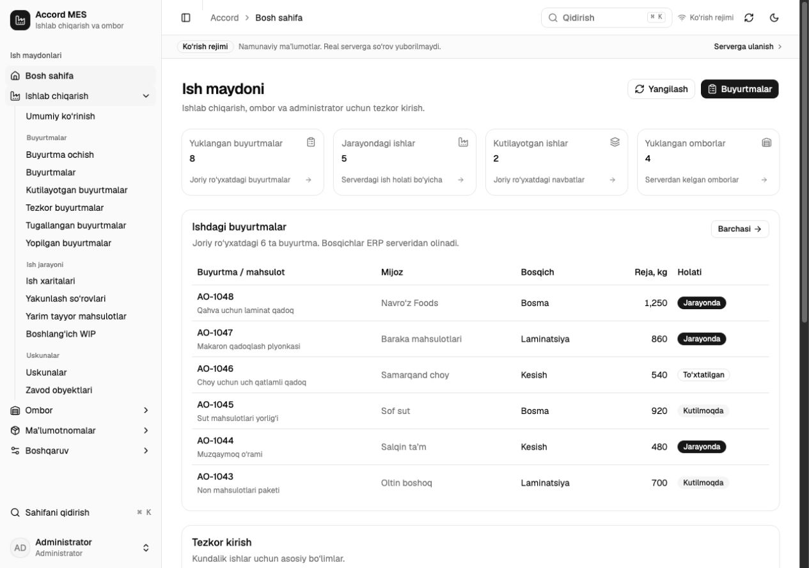

# Accord Web v2

Mini RS ERP uchun mustaqil MES va ombor web interfeysi. Hisob-kitoblar va biznes ma’lumotlari ERP serverida qoladi; web mavjud `/v1/mobile/*` API endpointlari orqali ishlaydi.

React, TypeScript va Vite asosida qurilgan. Interfeysda asl **shadcn/ui — Radix Nova, Neutral** komponentlari, Lucide ikonkalari va Geist shrifti ishlatiladi. API ma’lumotlari TanStack Query orqali olinadi.



## Ishga tushirish

Buyruqlarni `accord_web_v2` papkasida bajaring:

```sh
npm ci
npm run dev
```

Lokal manzil: [http://127.0.0.1:5174](http://127.0.0.1:5174).

```sh
npm run typecheck
npm test
npm run build
```

`npm run build` statik fayllarni `dist/` papkasiga chiqaradi. Build natijasini lokal ko‘rish:

```sh
npm run preview
```

Preview porti: `4174`.

## Ish maydonlari

Chap menyuda to‘rtta asosiy modul bor; sahifalar modul ichidagi guruhlarga joylashtirilgan:

- **Ishlab chiqarish:** buyurtmalar, ish xaritalari, yakunlash so‘rovlari, WIP va uskunalar.
- **Ombor:** omborlar, mahsulot va xomashyo qoldiqlari, zavod joylashuvlari.
- **Ma’lumotnomalar:** mahsulotlar, guruhlar, materiallar, mijozlar va ta’minotchilar.
- **Boshqaruv:** foydalanuvchilar, xodimlar, rollar, faoliyat tarixi, sozlamalar va server holati.

## Kirish va ko‘rish rejimi

Kirish sahifasida ERP server manzili, telefon raqami va kirish kodi kiritiladi. API qaytargan sessiyada `admin.access` huquqi bo‘lishi kerak. Hozirgi versiya administrator uchun tayyorlangan.

**Admin interfeysini ko‘rish** tugmasi alohida namuna rejimini ochadi. Undagi ma’lumotlar sintetik va lokal; ERP serveriga so‘rov yuborilmaydi, o‘zgarishlar serverga saqlanmaydi. Haqiqiy API xatolari namuna ma’lumotlari bilan almashtirilmaydi.

## Sessiya va kesh

- Token, profil, huquqlar va resurs biriktirmalari brauzerning `sessionStorage` xotirasida aniq ERP manziliga bog‘lab saqlanadi. Kirishda kiritilgan telefon raqami va kod saqlanmaydi.
- Server manzili va interfeysning rang rejimi brauzerning `localStorage` xotirasida qoladi.
- API javoblari faqat brauzer RAMidagi TanStack Query keshida turadi. Doimiy IndexedDB yoki offline ma’lumotlar keshi hali qo‘shilmagan.
- Kirish, chiqish, domen yoki hisob almashganda joriy so‘rovlar bekor qilinadi va query keshi tozalanadi. Eski so‘rov natijasi yangi sessiyani almashtirmaydi.
- Sessiyani tiklash paytida tarmoq uzilishi saqlangan sessiyani o‘chirmaydi. Tasdiqlangan `401` javobi yoki profil identifikatori/roli mos kelmasligi sessiyani bekor qiladi.

Frontend serveri statik fayllarni tarqatadi; unda biznes ma’lumotlari yoki foydalanuvchi sessiyalari saqlanmaydi. Brauzer bevosita tanlangan ERP serveriga ulanadi.

## Joylashtirish

`dist/` papkasini statik hostingda tarqating. React Router manzillari, masalan `/app/orders`, yangilanganda ham ochilishi uchun mavjud bo‘lmagan sahifa yo‘llarini **`index.html`** ga yo‘naltiradigan SPA fallback sozlang.

ERP serveri web domenidan kelgan CORS so‘rovlarini, `Authorization` va `Content-Type` headerlarini hamda `OPTIONS` so‘rovlarini qabul qilishi kerak. HTTPS orqali ochilgan web sahifadan HTTP ERP serveriga ulanishni brauzer bloklaydi; bunday joylashtirishda ERP manzili ham HTTPS bo‘lishi kerak.

## Yangi buyurtma uchun production map

Server hisobidan keyin **Mapni ulash** visual muharrirni ochadi. Tugunlarni surish, ulash, bosqich va mos apparat qo‘shish, parallel apparat guruhlari hamda Rezka kadrlarini jipslash/ajratish mobil ilovaning xarita formatidan foydalanadi. Xarita va buyurtma shabloni birgalikda mavjud `PUT /v1/mobile/admin/production-maps/with-order` endpointiga yuboriladi; buyurtma raqamini server beradi.

Hisob va xarita drafti sahifalar orasida faqat brauzer RAMida saqlanadi; domen yoki hisob almashganda tozalanadi. Namuna rejimida **Map muharririni ko‘rish** orqali interfeysni sinash mumkin, saqlash o‘chirilgan.

## Hozirgi chegaralar

Bu administrator webining ilk versiyasi. Mavjud buyurtmalarning xaritalarini tahrirlash, Telegram, trening va barcha o‘zgartirish amallari bilan to‘liq tenglik hali mavjud emas. Ko‘rsatilgan bo‘limlarda mavjud API imkoniyatlari ishlatiladi.

Haqiqiy ERP serverida administrator bilan kirish hali sinovdan o‘tkazilmagan.
